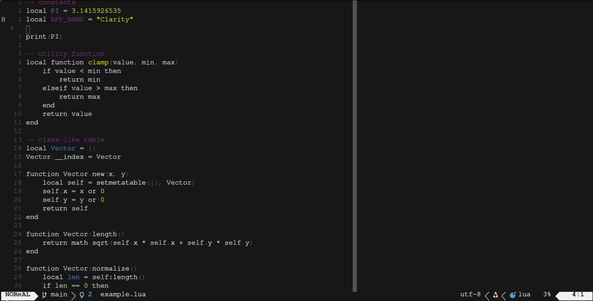
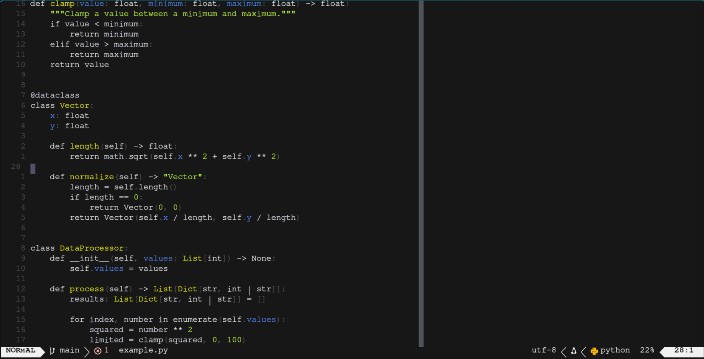
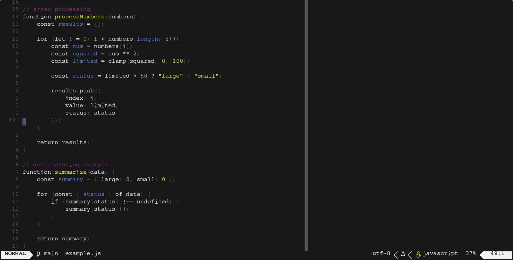

# A clone of [Clarity](https://github.com/ezpieco/clarity.nvim)

I really disliked the comment color so I changed it to something more boring. To avoid overwriting my change while updating I cloned the repository. All props go to the original creator linked above.

## Gallary

